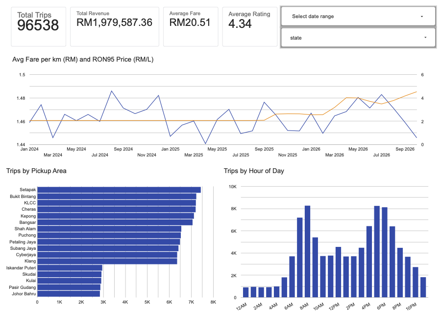
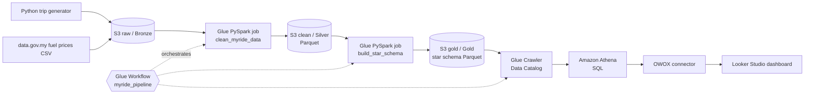
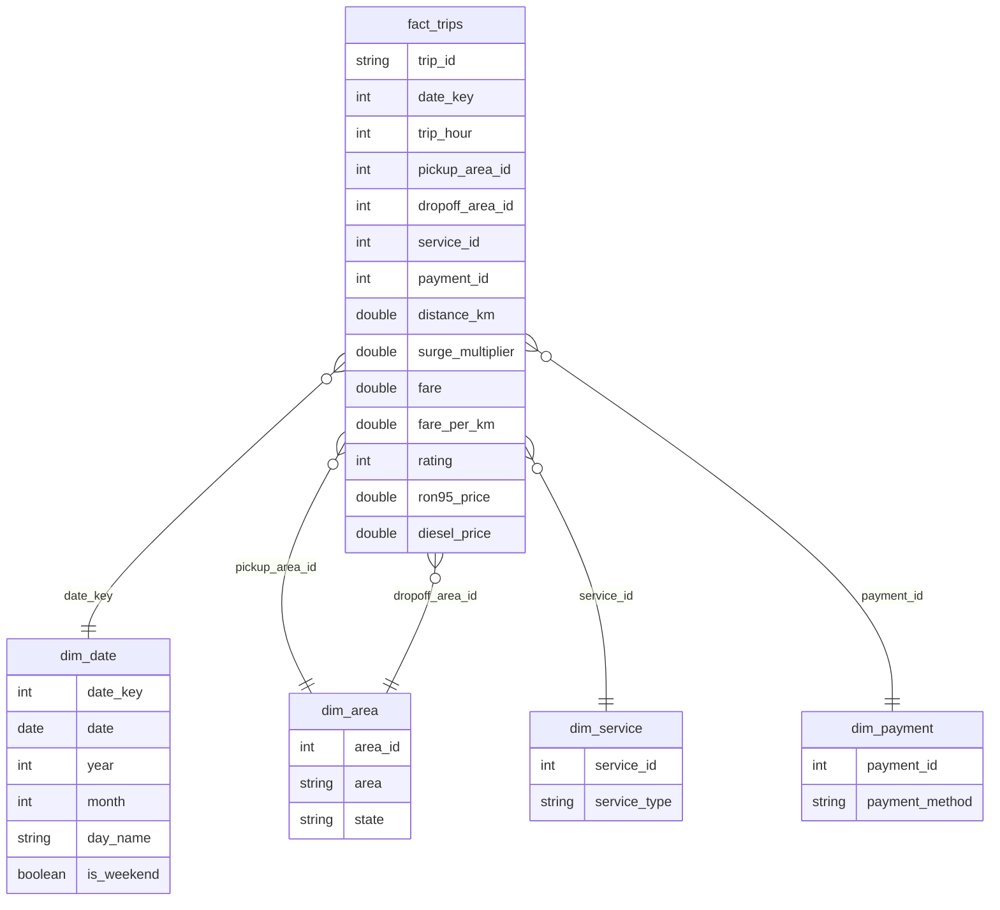

# Malaysia E-Hailing and Fuel Price Data Pipeline on AWS

An end-to-end data engineering project that ingests Malaysian e-hailing trip data and official weekly fuel prices, cleans and models them with **PySpark on AWS Glue**, stores them in an **S3 data lake** as a star schema, queries them with **Amazon Athena**, and presents insights in a **Looker Studio** dashboard. The whole pipeline is orchestrated with a **Glue Workflow**.



---

## Why this project

There is no public trip-level e-hailing dataset for Malaysia. Operators do not publish ride records. So I built:

1. **A trip simulator** that generates ~100,000 realistic rides across Kuala Lumpur, Selangor and Johor, with real-world mess deliberately injected (duplicates, missing values, mixed date formats, typos in place names, fares stored as text).
2. **An enrichment step** that joins every trip to the real weekly RON95 and diesel price published by the Ministry of Finance on [data.gov.my](https://data.gov.my/data-catalogue/fuelprice).

This lets the dashboard answer a real question: *when petrol prices change, do fares keep up?*

---

## Architecture



### Medallion layers in S3

| Layer | S3 path | Format | Contents |
|---|---|---|---|
| Bronze (raw) | `raw/trips/`, `raw/fuel/` | CSV | Data exactly as received, mess included |
| Silver (clean) | `clean/trips/`, `clean/fuel/` | Parquet | Deduplicated, typed, validated |
| Gold (modelled) | `gold/<table>/` | Parquet | Star schema ready for analytics |

---

## Tech stack

| Purpose | Tool |
|---|---|
| Storage (data lake) | Amazon S3 |
| Processing | PySpark on AWS Glue (2 workers) |
| Orchestration | AWS Glue Workflows + triggers |
| Metadata catalog | AWS Glue Crawler + Data Catalog |
| Query engine | Amazon Athena |
| Visualisation | Google Looker Studio (via OWOX Data Marts connector) |
| Scripting | Python, SQL, AWS CloudShell |
| Security & cost | IAM users and roles, MFA, AWS Budgets |

---

## Data sources

| Dataset | Source | Notes |
|---|---|---|
| E-hailing trips | Synthetic, generated by [`data_generator/generate_trips.py`](data_generator/generate_trips.py) | 102,000 rows (100,000 trips + 2% duplicates), Jan 2024 – Oct 2026 |
| Weekly fuel prices | [data.gov.my – Price of Petroleum & Diesel](https://data.gov.my/data-catalogue/fuelprice), Ministry of Finance | Licensed CC BY 4.0. Weekly RON95, RON97 and diesel prices |

**Simulator design choices**
- State split: 45% Kuala Lumpur, 40% Selangor, 15% Johor
- Hourly demand weighted for morning (7–9 AM) and evening (5–7 PM) rush hours
- Three service tiers (Economy, Premium, XL) with different base fares and per-km rates
- Surge pricing (1.2x–1.5x) only during rush hours
- Payment methods: E-Wallet, Card, Cash

---

## Data cleaning (Bronze → Silver)

[`glue_jobs/clean_myride_data.py`](glue_jobs/clean_myride_data.py)

| Problem in raw data | Fix |
|---|---|
| ~2% exact duplicate rows | `dropDuplicates()` |
| Place-name typos (`PJ`, `P. Jaya`, `JB`, `Johor Baru`, `KL`) | Lowercase + trim, then map to standard names |
| Two date formats (`yyyy-MM-dd HH:mm:ss` and `dd/MM/yyyy HH:mm`) | Try both with `coalesce(to_timestamp(...))` |
| Fares stored as text (`RM23.50`) | Strip `RM`, cast to double |
| Missing fares, invalid dates, negative distances | Filter out |
| Fuel file has both price levels and weekly changes | Keep only `series_type = 'level'` |

Result: **96,538 clean trips** written as Parquet.

---

## Data model (Silver → Gold)

[`glue_jobs/build_star_schema.py`](glue_jobs/build_star_schema.py)



**Point-in-time fuel join:** fuel prices change weekly, trips happen daily. Each trip date is matched to the *most recent* price announced on or before that date, using a window function ranked by `price_date` descending.

---

## Orchestration

A Glue Workflow (`myride_pipeline`) chains the pipeline with event triggers, so each step only starts when the previous one **succeeds**:

```
start_pipeline (on demand)
  → clean_myride_data
  → [after_clean: on SUCCEEDED] build_star_schema
  → [after_star: on SUCCEEDED] myride_gold_crawler
```

---

## Dashboard

Built in Looker Studio on top of a single wide query ([`sql/dashboard_data_mart.sql`](sql/dashboard_data_mart.sql)) that joins the star schema back together.

**Contents**
- Scorecards: Total Trips, Total Revenue, Average Fare, Average Rating
- Filters: date range and state
- Monthly fare per km vs RON95 price (dual axis)
- Trips by pickup area
- Trips by hour of day

---

## Key insights

| Metric | Value |
|---|---|
| Clean trips | 96,538 |
| Total revenue | RM1.98M |
| Average fare | RM20.51 |
| Average rating | 4.34 / 5 |

1. **Two clear rush hours.** Demand peaks at 7–8 AM and 5–6 PM, with roughly 8× the trips of the quietest overnight hours.
2. **Klang Valley dominates.** Each KL area handles ~7,300 trips and each Selangor area ~6,400, versus ~2,900 per Johor area.
3. **Fuel prices rose, fares didn't.** The RON95 price in the dataset steps up from about RM2.05 to above RM2.50 around October 2025, when the BUDI95 and SKPS targeted subsidy programmes began, and keeps climbing through 2026. Fare per km stays flat, which in a real market would mean shrinking driver margins after fuel costs.

> Insight 3 is partly an artefact of the simulator, which does not link fares to fuel prices. That finding motivates the planned v2 below.

---

## Challenges and what I learned

| Challenge | What happened | Fix |
|---|---|---|
| Spark timestamp parsing | First Glue run failed with `CANNOT_PARSE_TIMESTAMP`. Spark's ANSI mode throws on the first non-matching format instead of returning null | `spark.conf.set("spark.sql.ansi.enabled", "false")` so the fallback format can be tried |
| No native Athena connector in Looker Studio | Looker Studio has no built-in Athena source | Used the OWOX Data Marts connector with a dedicated read IAM user |
| No "Record Count" metric | The connector does not expose Record Count | Counted a non-null field (`fare`) after confirming cleaning removed null fares |
| Chart numbers far too low | Area chart showed ~4% of trips | Cross-filtering from a clicked bar in another chart. Learned to sanity-check totals across charts |
| Count vs Count Distinct | Count Distinct counts unique fare values, not trips | Use Count |
| "Completed" ≠ "Succeeded" | A Glue Workflow reports Completed even if a step fails | Always check each node's status in run details |
| Slow dashboard | Every chart re-joins five tables through Athena | Planned: pre-build a wide reporting table with CTAS |

---

## Security and cost

- Daily work done as an **IAM user with MFA**, not the root account
- Separate IAM role for Glue (`GlueMyRideRole`) and a separate IAM user for the dashboard connector
- **AWS Budgets** alert set before building anything
- Glue jobs run with only 2 workers. Athena charges only for data scanned, and Parquet keeps scans small
- Region: `ap-southeast-1` (Singapore)

---

## How to reproduce

1. **Create the bucket and load raw data** (AWS CloudShell):
   ```bash
   aws s3 mb s3://<your-bucket>
   curl -o fuelprice.csv https://storage.data.gov.my/commodities/fuelprice.csv
   aws s3 cp fuelprice.csv s3://<your-bucket>/raw/fuel/fuelprice.csv

   python3 data_generator/generate_trips.py
   aws s3 cp trips_raw.csv s3://<your-bucket>/raw/trips/trips_raw.csv
   ```
2. **Create an IAM role** for Glue with `AWSGlueServiceRole` and S3 access.
3. **Create two Glue Spark jobs** from the scripts in `glue_jobs/`, updating `BUCKET` in each.
4. **Create a Glue Crawler** on `s3://<your-bucket>/gold/` targeting a database named `myride_gold`.
5. **Create a Glue Workflow** chaining job 1 → job 2 → crawler with on-success triggers, then run it.
6. **Query in Athena** using `sql/sample_queries.sql`.
7. **Connect Looker Studio** via an Athena connector using `sql/dashboard_data_mart.sql`.

---

## Repository structure

```
├── README.md
├── data_generator/
│   └── generate_trips.py        # synthetic Malaysian e-hailing trips (with injected mess)
├── glue_jobs/
│   ├── clean_myride_data.py     # Bronze → Silver
│   └── build_star_schema.py     # Silver → Gold
├── sql/
│   ├── dashboard_data_mart.sql  # wide query feeding Looker Studio
│   └── sample_queries.sql       # Athena analysis queries
└── images/
    └── dashboard.png
```

---

## Future improvements

- [ ] **Automated fuel ingestion:** add a first workflow step that downloads the latest data.gov.my prices weekly, then schedule the workflow
- [ ] **Simulator v2:** make fares respond to fuel prices so the fuel–fare relationship is realistic
- [ ] **Faster dashboard:** materialise the wide table with Athena CTAS
- [ ] **Least-privilege IAM:** restrict roles to this project's bucket instead of full S3 access
- [ ] **Partitioning:** partition the fact table by year and month to cut Athena scan costs
- [ ] **Data quality checks:** add row-count and null checks between layers

---

## Acknowledgements

- Project idea inspired by [Katie Huang's Uber Project](https://github.com/katiehuangx/data-engineering) and [Darshil Parmar's Uber ETL tutorial](https://github.com/darshilparmar/uber-etl-pipeline-data-engineering-project)
- Fuel price data: Ministry of Finance Malaysia via [data.gov.my](https://data.gov.my), CC BY 4.0

---

## Author

**Erlangga**: transitioning into data analytics and engineering, with a background in mechanical engineering.

[LinkedIn](#) · [Looker Studio dashboard](#)
